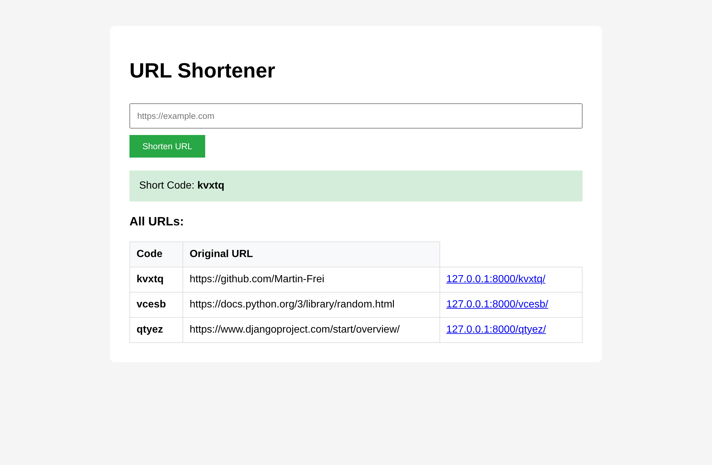

# 🔗 Django URL Shortener


> **A small URL shortener built with Django: enter a long URL, get a random five-letter short code, and see all stored URLs in a table.**



## ✨ Features

- ✂️ **Create short codes** – every valid URL gets a random five-letter code
- ✅ **Validation** – a Django `ModelForm` rejects anything that is not a URL
- 🗂️ **Overview table** – all stored URLs, newest first
- 🛠️ **Django admin** – available under `/admin/`

## 🚧 Status

This is a learning project and not finished yet:

- The **redirect** from a short code to the original URL is prepared in `short/views.py` and `shortUrl/urls.py`, but still commented out. The links in the table therefore do not work yet.
- Short codes are random and not checked for collisions before saving.

## 🛠️ Tech Stack

- **Django 5.1** – models, ModelForm, templates
- **SQLite** – database (Django default)

## ▶️ Run Locally

```bash
git clone https://github.com/Martin-Frei/Django_shortUrl.git
cd Django_shortUrl
python -m venv venv
source venv/bin/activate        # Windows: venv\Scripts\activate
pip install -r requirements.txt
python manage.py migrate
python manage.py runserver
```

Then open <http://127.0.0.1:8000/>.

## ⚙️ Configuration

The project runs locally without any configuration. For a deployment, set these environment variables:

| Variable | Default | Purpose |
|----------|---------|---------|
| `DJANGO_SECRET_KEY` | insecure development key | Secret key – **must** be set in production |
| `DJANGO_DEBUG` | `True` | Set to `False` in production |
| `DJANGO_ALLOWED_HOSTS` | empty | Comma-separated host names, e.g. `example.com,www.example.com` |

## 📂 Project Structure

```
Django_shortUrl/
├── short/              # App: model, form, view
│   ├── models.py       # shortUrl (longUrl, shortUrlField)
│   ├── forms.py        # shortUrlForm (ModelForm)
│   └── views.py        # getUrl
├── shortUrl/           # Project: settings, urls
├── templates/
│   └── urlShort.html
├── screenshots/
├── manage.py
└── requirements.txt
```

## 🎓 What I Learned

- Defining a model and creating migrations
- Validating input with a `ModelForm`
- Creating and querying objects with the Django ORM
- Rendering query results in a template

## 👨‍💻 Author

**Martin Freimuth**
- GitHub: [@Martin-Frei](https://github.com/Martin-Frei)
- LinkedIn: [martin-freimuth](https://www.linkedin.com/in/martin-freimuth-089249359/)
